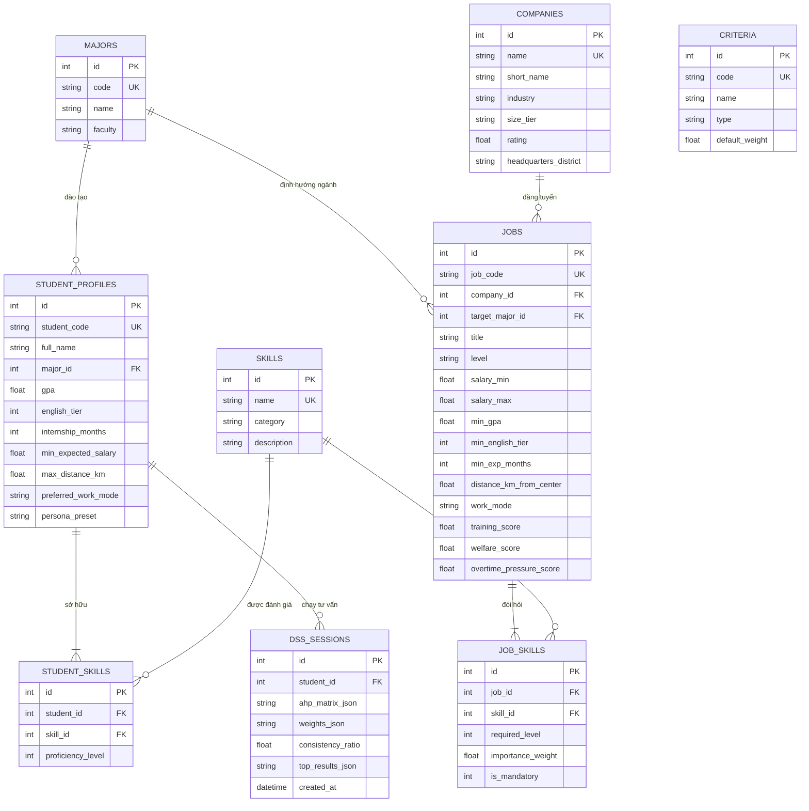
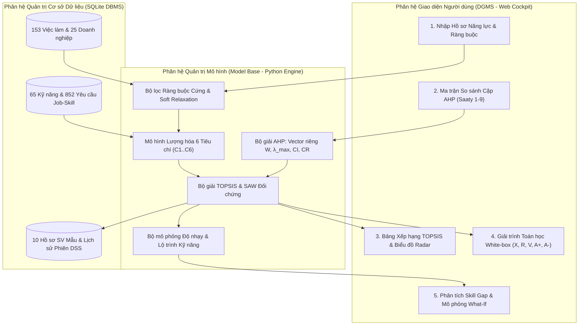

# BÁO CÁO GIỮA KỲ MÔN HỌC: HỆ TRỢ GIÚP QUYẾT ĐỊNH (DECISION SUPPORT SYSTEMS)

**ĐỀ TÀI: HỆ TRỢ GIÚP QUYẾT ĐỊNH TÌM VIỆC LÀM CHO SINH VIÊN TỐT NGHIỆP (HUST CareerDSS)**

---

## CHƯƠNG 1. PHÂN TÍCH BÀI TOÁN & THIẾT KẾ CƠ SỞ DỮ LIỆU

### 1.1. Đặt vấn đề và Bản chất Bài toán Ra quyết định
Mỗi năm, hàng nghìn sinh viên tốt nghiệp từ các trường đại học kỹ thuật và kinh tế (như Đại học Bách Khoa Hà Nội - HUST) bước vào thị trường lao động. Sinh viên mới ra trường thường đứng trước một bài toán ra quyết định phức tạp: **"Nên ưu tiên ứng tuyển và lựa chọn vị trí công việc nào trong hàng trăm tin tuyển dụng trên thị trường?"**

Dưới góc độ lý thuyết **Hệ trợ giúp quyết định (Decision Support Systems - DSS)** của Simon (1977) và Turban, đây là một **bài toán bán cấu trúc (Semi-structured Decision Problem)** và **đa mục tiêu (Multi-Criteria Decision Making - MCDM)** vì các lý do sau:
1. **Sự xung đột giữa các tiêu chí (Conflicting Criteria)**:
   - Một công việc có mức lương khởi điểm rất cao ($C_2$) thường đi kèm yêu cầu kỹ năng khắt khe ($C_1$), áp lực làm thêm giờ lớn hoặc khoảng cách đi lại xa ($C_6$).
   - Một chương trình Fresher/Management Trainee có lộ trình đào tạo bài bản ($C_4$) có thể trả mức lương ban đầu vừa phải nhưng mang lại giá trị phát triển dài hạn vượt trội.
2. **Sự kết hợp giữa dữ liệu định lượng và đánh giá chủ quan**:
   - Có những yếu tố có cấu trúc rõ ràng (mức lương, khoảng cách km, điểm GPA tối thiểu, số kỹ năng trùng khớp).
   - Có những yếu tố phụ thuộc hoàn toàn vào **thang ưu tiên cá nhân của từng sinh viên** (sinh viên A cần thu nhập ngay để trang trải cuộc sống; sinh viên B ưu tiên học hỏi từ Mentor giỏi; sinh viên C ưu tiên môi trường cân bằng cuộc sống và gần nơi ở).
3. **Không gian phương án lớn**:
   - Sinh viên không thể tự tính nhẩm và so sánh đồng thời 100–200 tin tuyển dụng trên 6–7 tiêu chí khác nhau kèm hàng chục kỹ năng chuyên môn nếu không có công cụ mô hình hóa toán học.

---

### 1.2. Xác định Hệ thống Các Biến của Bài toán

Hệ thống biến trong mô hình được phân chia thành 4 nhóm rõ ràng:

#### A. Nhóm biến Hồ sơ Năng lực Sinh viên (Decision Maker Profile Variables)
| Ký hiệu | Tên biến trong CSDL | Kiểu dữ liệu / Miền giá trị | Ý nghĩa thực tiễn |
| :--- | :--- | :--- | :--- |
| $M_{stu}$ | `major_code` | Mã ngành (`IT1`, `IT2`, `DS1`, `EE1`, `EE2`, `ME1`, `EM1`, `EM2`) | Ngành đào tạo của sinh viên tại trường đại học |
| $G_{stu}$ | `gpa` | Số thực $\in [0.0, 4.0]$ | Điểm trung bình tích lũy thang 4.0 |
| $E_{stu}$ | `english_tier` | Số nguyên $\in \{1, 2, 3, 4, 5, 6\}$ | Bậc ngoại ngữ quy đổi CEFR (A1 $\to$ C2, tương ứng TOEIC/IELTS/JLPT) |
| $T_{stu}$ | `internship_months` | Số nguyên $\ge 0$ (tháng) | Thời gian thực tập hoặc làm dự án thực tế tích lũy |
| $S_{stu}$ | `student_skills` | Tập các cặp $(s_k, l_{stu,k} \in \{1..5\})$ | Danh sách kỹ năng sinh viên sở hữu và mức độ thành thạo (1: Cơ bản $\to$ 5: Xuất sắc) |

#### B. Nhóm biến Ràng buộc Cứng (Hard Constraint Variables)
| Ký hiệu | Tên biến | Kiểu dữ liệu | Vai trò trong Giai đoạn Lọc Sơ bộ |
| :--- | :--- | :--- | :--- |
| $Sal_{\min}$ | `min_expected_salary` | Triệu VNĐ/tháng | Loại bỏ các công việc có mức lương trần thấp hơn kỳ vọng tối thiểu (`salary_max < min_expected_salary`) |
| $Dist_{\max}$ | `max_distance_km` | Kilômét (km) | Loại bỏ các công việc có khoảng cách di chuyển thực tế vượt quá giới hạn chấp nhận |
| $Mode_{pref}$ | `preferred_work_mode` | `Any` / `Onsite` / `Hybrid` / `Remote` | Lọc theo hình thức làm việc mong muốn |
| $Strict_{maj}$ | `strict_major_only` | Boolean (`0` hoặc `1`) | Chỉ xét việc làm đúng mã ngành hoặc cho phép xét cả các ngành gần có độ tương thích $\ge 0.58$ |

#### C. Nhóm biến Thuộc tính của Phương án Việc làm (Alternative Attributes - $A_i$)
Mỗi vị trí tuyển dụng $A_i$ ($i = 1 \dots m$) trong cơ sở dữ liệu bao gồm:
- Thông tin định danh: `job_code`, `title`, `company_id`, `target_major_id`, `level` (`Intern`, `Fresher`, `Junior`, `Management Trainee`).
- Dải lương chi trả: $[Sal_{i,\min}, Sal_{i,\max}]$ (Triệu VNĐ/tháng).
- Yêu cầu đầu vào tối thiểu: `min_gpa`, `min_english_tier`, `min_exp_months`.
- Tập yêu cầu kỹ năng $S_{job,i} = \{(s_k, l_{job,ik}, \omega_{ik}, \text{mand}_{ik})\}$: gồm mã kỹ năng $s_k$, mức độ yêu cầu $l_{job,ik} \in \{1..5\}$, trọng số quan trọng $\omega_{ik} \in [0.5, 3.0]$ và cờ bắt buộc $\text{mand}_{ik} \in \{0, 1\}$.
- Các chỉ số đánh giá môi trường công việc: `training_score` ($\in [1, 10]$), `welfare_score` ($\in [1, 10]$), `overtime_pressure_score` ($\in [1, 10]$), `distance_km_from_center`, `work_mode`.

#### D. Nhóm 6 Biến Tiêu chí Quyết định ($C_1 \dots C_6$) & Biến Đầu ra Mô hình
| Mã | Tên tiêu chí đánh giá | Loại tiêu chí | Đơn vị / Thang đo | Trọng số mặc định |
| :---: | :--- | :---: | :---: | :---: |
| **$C_1$** | **Độ khớp Kỹ năng Chuyên môn & Công nghệ** | **BENEFIT** (Càng cao càng tốt) | Điểm $[0, 100]$ | $0.28$ |
| **$C_2$** | **Mức Thu nhập Kỳ vọng & Đãi ngộ Tài chính** | **BENEFIT** (Càng cao càng tốt) | Triệu VNĐ/tháng | $0.22$ |
| **$C_3$** | **Độ phù hợp Học vấn, Chuyên ngành & Ngoại ngữ** | **BENEFIT** (Càng cao càng tốt) | Điểm $[0, 10]$ | $0.16$ |
| **$C_4$** | **Cơ hội Đào tạo, Mentorship & Thăng tiến** | **BENEFIT** (Càng cao càng tốt) | Điểm $[1, 10]$ | $0.15$ |
| **$C_5$** | **Phúc lợi, Văn hóa & Uy tín Doanh nghiệp** | **BENEFIT** (Càng cao càng tốt) | Điểm $[1, 10]$ | $0.10$ |
| **$C_6$** | **Chi phí Khoảng cách Di chuyển & Áp lực OT** | **COST** (Càng thấp càng tốt) | Điểm chi phí $[1, 10]$ | $0.09$ |

---

### 1.3. Thiết kế Cơ sở Dữ liệu Quan hệ & Sơ đồ ERD

Cơ sở dữ liệu của hệ thống (`backend/database/dss_job_matching.db`) được thiết kế chuẩn hóa đạt dạng chuẩn 3NF gồm **9 bảng quan hệ**:
1. `majors`: Lưu danh mục 8 ngành đào tạo tiêu biểu tại ĐHBK Hà Nội.
2. `skills`: Lưu từ điển 65 kỹ năng phân theo 8 nhóm (`Programming`, `Web_Mobile`, `Data_AI`, `System_DevOps`, `Embedded_Hardware`, `Business_Domain`, `SoftSkill`, `Language`).
3. `companies`: Lưu thông tin 25 doanh nghiệp công nghệ, sản xuất, ngân hàng và tư vấn hàng đầu tại Việt Nam.
4. `jobs`: Lưu 153 vị trí việc làm dành cho sinh viên mới tốt nghiệp (Intern, Fresher, Junior, Management Trainee).
5. `job_skills`: Bảng trung gian biểu diễn quan hệ nhiều-nhiều giữa `jobs` và `skills` (852 bản ghi yêu cầu kỹ năng kèm trọng số và cờ bắt buộc).
6. `student_profiles`: Lưu 10 hồ sơ sinh viên tốt nghiệp mẫu đại diện cho các ngành và định hướng nghề nghiệp khác nhau.
7. `student_skills`: Lưu kỹ năng hiện có và mức độ thành thạo (1–5) của từng sinh viên (87 bản ghi).
8. `criteria`: Lưu cấu hình 6 tiêu chí đánh giá ($C_1 \dots C_6$) của mô hình DSS.
9. `dss_sessions`: Lưu lịch sử các phiên chạy mô hình, ma trận AHP, tỷ số nhất quán $CR$ và kết quả xếp hạng TOPSIS.

### 1.4. Thống kê Bộ Dữ liệu Phong phú Minh họa Bài toán
Bộ dữ liệu được xây dựng dựa trên khảo sát thực tế thị trường tuyển dụng kỹ sư và cử nhân mới tốt nghiệp tại Hà Nội (Viettel, FPT Software, VNG, Shopee, VinBigdata, Samsung R&D, Bosch, LG R&D, Techcombank, MB Bank, MISA, NashTech, Sun*, One Mount, Dolphin Tech, ABB, Siemens, Canon, KPMG...):
- **Tổng số ngành đào tạo**: 8 ngành (CNTT Khoa học máy tính, Kỹ thuật phần mềm, Khoa học dữ liệu & AI, Điện - Điện tử, Điều khiển & Tự động hóa, Cơ điện tử, Hệ thống thông tin quản lý, Quản trị kinh doanh công nghệ & Logistics).
- **Tổng số kỹ năng**: 65 kỹ năng chuyên môn, công cụ, ngoại ngữ và kỹ năng mềm.
- **Tổng số vị trí tuyển dụng**: **153 việc làm** với **852 mối quan hệ yêu cầu kỹ năng (`job_skills`)**.
- **Tổng số hồ sơ sinh viên mẫu**: **10 hồ sơ sinh viên** đa dạng điểm GPA ($2.68 \to 3.52$), ngoại ngữ và định hướng nghề nghiệp.

---

## CHƯƠNG 2. ĐỀ XUẤT PHƯƠNG PHÁP & MÔ HÌNH TOÁN HỌC TRỢ GIÚP QUYẾT ĐỊNH

### 2.1. Kiến trúc Tổng thể Hệ Trợ giúp Quyết định (DSS Architecture)
Hệ thống được thiết kế tuân thủ kiến trúc chuẩn của một Hệ trợ giúp quyết định hiện đại gồm 4 phân hệ:
1. **Phân hệ Quản trị Dữ liệu (DBMS - Database Management System)**: Cơ sở dữ liệu SQLite lưu trữ cấu trúc hóa thông tin việc làm, doanh nghiệp, từ điển kỹ năng, hồ sơ năng lực sinh viên và lịch sử phiên ra quyết định.
2. **Phân hệ Quản trị Mô hình (MBMS - Model Base Management System)**: Kết hợp 5 mô hình con hoạt động nối tiếp:
   - *Mô hình 1*: Bộ lọc Ràng buộc Cứng & Nới lỏng Mềm (Hard-Constraint Filter with Soft Relaxation).
   - *Mô hình 2*: Bộ lượng hóa Độ khớp Hồ sơ - Kỹ năng Đa chiều ($C_1 \dots C_6$).
   - *Mô hình 3*: Mô hình Phân tích Thứ bậc **AHP (Analytic Hierarchy Process)** xác định trọng số ưu tiên cá nhân và kiểm tra tính nhất quán ($CR < 0.10$).
   - *Mô hình 4*: Mô hình Xếp hạng theo Khoảng cách tới Giải pháp Lý tưởng **TOPSIS** (kèm đối chứng với mô hình **SAW - Simple Additive Weighting**).
   - *Mô hình 5*: Bộ phân tích Khoảng trống Kỹ năng (**Skill Gap Roadmap**) và Mô phỏng Độ nhạy (**What-If Sensitivity Simulator**).
3. **Phân hệ Quản trị Giao diện & Đối thoại (DGMS - Dialog Generation and Management System)**: Giao diện Web Dashboard trực quan cho phép sinh viên điều chỉnh ma trận so sánh cặp, xem biểu đồ Radar, kiểm tra ma trận toán học trung gian và chạy mô phỏng giả định.
4. **Người ra quyết định (Decision Maker)**: Sinh viên tốt nghiệp hoặc Cố vấn học tập / Tư vấn hướng nghiệp.

---

### 2.2. Công thức Toán học Lượng hóa 6 Tiêu chí Đánh giá ($C_1 \dots C_6$)

Trước khi đưa vào ma trận quyết định TOPSIS, hệ thống chuyển đổi dữ liệu thô của hồ sơ sinh viên và từng công việc $i$ thành 6 chỉ số định lượng chuẩn xác:

#### 1. Tiêu chí $C_1$ — Độ khớp Kỹ năng Chuyên môn & Công nghệ (`BENEFIT`, thang $0..100$):
Gọi $S_i$ là tập kỹ năng mà công việc $i$ yêu cầu. Với mỗi kỹ năng $k \in S_i$, gọi $l_{job,ik} \in \{1..5\}$ là mức độ yêu cầu, $\omega_{ik} \in [0.5, 3.0]$ là trọng số tầm quan trọng của kỹ năng đó trong công việc $i$, và $l_{stu,k} \in \{0..5\}$ là mức độ thành thạo hiện tại của sinh viên. Điểm đáp ứng thành phần $\phi_{ik}$ được tính như sau:
$$\phi_{ik} = \begin{cases} \min\left(1.08,\; 1.0 + 0.04(l_{stu,k} - l_{job,ik})\right) & \text{nếu } l_{stu,k} \ge l_{job,ik} \text{ (Đạt hoặc vượt yêu cầu)} \\ 0.85 \times \dfrac{l_{stu,k}}{l_{job,ik}} & \text{nếu } 0 < l_{stu,k} < l_{job,ik} \text{ (Đáp ứng một phần)} \\ 0 & \text{nếu } l_{stu,k} = 0 \text{ (Chưa có kỹ năng)} \end{cases}$$

Gọi $m_{miss,i}$ là số lượng kỹ năng **bắt buộc** (`is_mandatory = 1`) mà sinh viên chưa có ($l_{stu,k} = 0$). Điểm độ khớp kỹ năng tổng hợp $C_{1,i}$ là:
$$C_{1,i} = \left(100 \times \frac{\sum_{k \in S_i} \omega_{ik} \cdot \phi_{ik}}{\sum_{k \in S_i} \omega_{ik}}\right) \times (0.86)^{m_{miss,i}}$$

#### 2. Tiêu chí $C_3$ — Độ phù hợp Học vấn, Chuyên ngành, GPA & Ngoại ngữ (`BENEFIT`, thang $0..10$):
Kết hợp có trọng số từ 4 yếu tố: Độ tương thích ngành học $F_{major} \in [4.0, 10.0]$ (tra từ ma trận tương thích ngành `MAJOR_AFFINITY`), độ đáp ứng điểm trung bình tích lũy $F_{gpa}$, độ đáp ứng trình độ ngoại ngữ $F_{eng}$ và độ đáp ứng kinh nghiệm thực tập $F_{exp}$:
$$C_{3,i} = 0.40 \cdot F_{major,i} + 0.25 \cdot F_{gpa,i} + 0.20 \cdot F_{eng,i} + 0.15 \cdot F_{exp,i}$$

#### 3. Tiêu chí $C_2$ — Mức Thu nhập Kỳ vọng dành cho Sinh viên (`BENEFIT`, Triệu VNĐ/tháng):
Thay vì chỉ lấy trung bình cộng cố định của dải lương $[Sal_{i,\min}, Sal_{i,\max}]$, hệ thống nội suy mức lương offer dự kiến dựa trên năng lực thực tế của sinh viên đối với công việc $i$:
$$\eta_i = 0.65 \left(\frac{C_{1,i}}{100}\right) + 0.35 \left(\frac{C_{3,i}}{10}\right), \qquad C_{2,i} = Sal_{i,\min} + \eta_i \cdot (Sal_{i,\max} - Sal_{i,\min})$$

#### 4. Tiêu chí $C_4$ — Cơ hội Đào tạo, Mentorship & Thăng tiến (`BENEFIT`, thang $1..10$):
$$C_{4,i} = \min\left(10.0,\; \text{TrainingScore}_i + \Delta_{\text{level}}\right)$$
trong đó $\Delta_{\text{level}} = 0.3$ nếu sinh viên mới có ít kinh nghiệm ($\le 4$ tháng) và ứng tuyển vị trí `Fresher` hoặc `Management Trainee` (nơi có chương trình đào tạo bài bản).

#### 5. Tiêu chí $C_5$ — Phúc lợi, Văn hóa & Uy tín Doanh nghiệp (`BENEFIT`, thang $1..10$):
$$C_{5,i} = 0.70 \cdot \text{WelfareScore}_i + 0.30 \cdot (2.0 \times \text{CompanyRating}_i)$$

#### 6. Tiêu chí $C_6$ — Chi phí Khoảng cách Di chuyển & Áp lực OT (`COST` - Càng nhỏ càng tốt, thang $1..10$):
Khoảng cách di chuyển hiệu dụng $d_{eff,i}$ được điều chỉnh theo hình thức làm việc ($0.25 d_i$ nếu `Remote`, $0.65 d_i$ nếu `Hybrid`, và $1.0 d_i$ nếu `Onsite`):
$$C_{6,i} = 0.45 \cdot \min\left(10.0, \max\left(1.0, \frac{d_{eff,i}}{2.0}\right)\right) + 0.55 \cdot \text{OvertimePressureScore}_i$$

---

### 2.3. Mô hình Xác định Trọng số Tiêu chí bằng AHP (Analytic Hierarchy Process)

Phương pháp **AHP** do GS. Thomas L. Saaty đề xuất cho phép chuyển đổi các phán đoán so sánh cặp định tính của sinh viên thành vector trọng số định lượng chặt chẽ và kiểm soát được mâu thuẫn tư duy:

1. **Thiết lập Ma trận So sánh Cặp $A = [a_{jk}]_{n \times n}$ ($n = 6$)**:
   - Phần tử $a_{jk}$ biểu thị mức độ quan trọng của tiêu chí $C_j$ so với tiêu chí $C_k$ theo thang đo Saaty từ $1$ (ngang nhau) đến $9$ (quan trọng hơn tuyệt đối).
   - Ma trận thỏa mãn tính chất đối xứng nghịch đảo: $a_{jj} = 1$ và $a_{kj} = \dfrac{1}{a_{jk}}$ với mọi $j, k = 1 \dots 6$.
2. **Chuẩn hóa Ma trận theo Cột và Tính Vector Trọng số $W = [w_1, w_2, \dots, w_6]^T$**:
   $$n_{jk} = \frac{a_{jk}}{\sum_{p=1}^{n} a_{pk}}, \qquad w_j = \frac{1}{n} \sum_{k=1}^{n} n_{jk}, \qquad \sum_{j=1}^{n} w_j = 1.0$$
3. **Kiểm định Tính Nhất quán (Consistency Verification)**:
   - Tính vector tổng trọng số $A \cdot W$ và giá trị riêng lớn nhất $\lambda_{\max}$:
     $$\lambda_{\max} = \frac{1}{n} \sum_{j=1}^{n} \frac{(A \cdot W)_j}{w_j}$$
   - Tính Chỉ số Nhất quán ($CI$ - Consistency Index) và Tỷ số Nhất quán ($CR$ - Consistency Ratio):
     $$CI = \frac{\lambda_{\max} - n}{n - 1}, \qquad CR = \frac{CI}{RI_n}$$
   - Với $n = 6$ tiêu chí, chỉ số ngẫu nhiên chuẩn của Saaty là **$RI_6 = 1.24$**.
   - **Quy tắc ra quyết định**:
     - Nếu $CR < 0.10$ ($10\%$): Ma trận so sánh cặp đảm bảo tính nhất quán bắc cầu, trọng số $W$ được chấp nhận.
     - Nếu $CR \ge 0.10$: Hệ thống tự động định vị cặp tiêu chí $(j, k)$ có sai lệch logarit lớn nhất $\epsilon_{jk} = \left|\ln(a_{jk}) - \ln\left(\dfrac{w_j}{w_k}\right)\right|$ và gợi ý giá trị hiệu chỉnh $a_{jk}^* \approx \dfrac{w_j}{w_k}$.

---

### 2.4. Mô hình Xếp hạng Phương án bằng TOPSIS

Sau khi có danh sách $m$ công việc vượt qua bước lọc ràng buộc và vector trọng số $W = [w_1 \dots w_6]^T$ từ AHP, hệ thống áp dụng thuật toán **TOPSIS** (Hwang & Yoon, 1981):

- **Bước 1: Lập Ma trận Quyết định Gốc $X = [x_{ij}]_{m \times 6}$**, trong đó $x_{ij}$ là điểm của công việc $i$ tại tiêu chí $C_j$.
- **Bước 2: Chuẩn hóa Vector Euclid để khử đơn vị đo**:
  $$r_{ij} = \frac{x_{ij}}{\sqrt{\sum_{k=1}^{m} x_{kj}^2}}, \qquad i = 1 \dots m;\; j = 1 \dots 6$$
- **Bước 3: Xây dựng Ma trận Chuẩn hóa có Trọng số $V = [v_{ij}]_{m \times 6}$**:
  $$v_{ij} = w_j \cdot r_{ij}$$
- **Bước 4: Xác định Giải pháp Lý tưởng Tốt ($A^+$) và Giải pháp Lý tưởng Xấu ($A^-$)**:
  Do $J^+ = \{C_1, C_2, C_3, C_4, C_5\}$ là tập tiêu chí lợi ích (`BENEFIT`) và $J^- = \{C_6\}$ là tiêu chí chi phí (`COST`):
  $$A^+ = \{v_1^+, v_2^+, \dots, v_6^+\} \quad \text{với } v_j^+ = \begin{cases} \max_i v_{ij} & \text{nếu } j \in J^+ \\ \min_i v_{ij} & \text{nếu } j \in J^- \end{cases}$$
  $$A^- = \{v_1^-, v_2^-, \dots, v_6^-\} \quad \text{với } v_j^- = \begin{cases} \min_i v_{ij} & \text{nếu } j \in J^+ \\ \max_i v_{ij} & \text{nếu } j \in J^- \end{cases}$$
- **Bước 5: Tính Khoảng cách Euclid $D_i^+$ và $D_i^-$ của mỗi công việc tới $A^+$ và $A^-$**:
  $$D_i^+ = \sqrt{\sum_{j=1}^{6} (v_{ij} - v_j^+)^2}, \qquad D_i^- = \sqrt{\sum_{j=1}^{6} (v_{ij} - v_j^-)^2}$$
- **Bước 6: Tính Hệ số Tương tự Lý tưởng $C_i^*$ và Xếp hạng**:
  $$C_i^* = \frac{D_i^-}{D_i^+ + D_i^-}, \qquad C_i^* \in [0, 1]$$
  Phương án có $C_i^*$ càng gần $1.0$ thì càng gần giải pháp lý tưởng tốt $A^+$ và càng xa giải pháp lý tưởng xấu $A^-$.

---

## CHƯƠNG 3. KẾT QUẢ THỰC NGHIỆM & CÀI ĐẶT HỆ THỐNG

### 3.1. Thực nghiệm Minh họa trên Hồ sơ Sinh viên Mẫu #1
- **Sinh viên**: Nguyễn Minh Quân (`MSSV: 20215001`), Ngành Khoa học Dữ liệu & AI (`DS1`), `GPA = 3.45/4.0`, `IELTS 7.0` (Bậc 5), Thực tập `6 tháng`, sở hữu 11 kỹ năng (Python 5/5, Machine Learning 4/5, Deep Learning 4/5, NLP/LLM 4/5, Pandas/NumPy 5/5, SQL 4/5...).
- **Cấu hình AHP**: `growth_focused` (Ưu tiên Đào tạo & Phát triển sự nghiệp).
  - Kết quả tính AHP: $W = [0.2706,\; 0.1282,\; 0.1282,\; 0.2706,\; 0.1112,\; 0.0912]^T$.
  - Kiểm định nhất quán: $\lambda_{\max} = 6.0085$, $CI = 0.0017$, **$CR = 0.0014 = 0.14\% < 10\%$** (Hoàn toàn nhất quán).
- **Kết quả lọc và xếp hạng TOPSIS**:
  - Từ 153 việc làm trong CSDL, hệ thống lọc ra các vị trí phù hợp với nhóm ngành AI/Data/CNTT và thỏa mãn ràng buộc lương $\ge 13.0$ triệu VNĐ, khoảng cách $\le 14.0$ km.
  - **Top 5 Việc làm Khuyến nghị Cao nhất**:

| Hạng TOPSIS | Mã CV | Vị trí Tuyển dụng & Doanh nghiệp | $C_1$ (Kỹ năng) | $C_2$ (Lương dự kiến) | $C_3$ (Hồ sơ) | $C_4$ (Đào tạo) | $C_5$ (Phúc lợi) | $C_6$ (Chi phí) | $D_i^+$ | $D_i^-$ | **$C_i^*$** | Hạng SAW |
| :---: | :---: | :--- | :---: | :---: | :---: | :---: | :---: | :---: | :---: | :---: | :---: | :---: |
| **#1** | `JOB-058` | **Fresher AI / ML Engineer (NLP & GenAI) - VNG** | 95.8% | 23.62 tr | 9.68 | 9.60 | 9.31 | 4.86 | 0.0061 | 0.0785 | **0.9279** | #1 |
| **#2** | `JOB-056` | **Fresher AI / ML Engineer (NLP & GenAI) - FPT Smart Cloud** | 95.8% | 22.84 tr | 9.68 | 9.50 | 8.85 | 5.29 | 0.0091 | 0.0762 | **0.8933** | #2 |
| **#3** | `JOB-059` | **Fresher AI / ML Engineer (NLP & GenAI) - MoMo** | 95.8% | 23.54 tr | 9.68 | 9.20 | 9.01 | 5.19 | 0.0095 | 0.0754 | **0.8881** | #3 |
| **#4** | `JOB-054` | **Fresher AI / ML Engineer (NLP & GenAI) - VinBigdata** | 95.8% | 22.92 tr | 9.68 | 9.30 | 9.02 | 5.65 | 0.0108 | 0.0748 | **0.8738** | #4 |
| **#5** | `JOB-065` | **Junior Data Scientist (Risk & Recommendation) - Techcombank** | 94.0% | 23.38 tr | 9.68 | 9.40 | 9.31 | 5.18 | 0.0112 | 0.0744 | **0.8692** | #5 |

### 3.2. Hướng dẫn Khởi chạy và Sử dụng Phần mềm
1. **Cách 1 (Khởi chạy đầy đủ Backend SQLite + Giao diện Web trên cổng 8000)**:
   - Nháy đúp vào tệp `run_dss_app.bat` ở thư mục gốc (hoặc chạy lệnh `python backend/main.py`), sau đó mở trình duyệt tại địa chỉ `http://127.0.0.1:8000`.
2. **Cách 2 (Mở nhanh Giao diện trực tiếp)**:
   - Mở trực tiếp tệp `frontend/index.html` trên trình duyệt Web bất kỳ (Chrome, Edge, Firefox). Hệ thống tích hợp sẵn bản Snapshot toàn bộ 153 việc làm từ SQLite để tính toán và hiển thị ngay lập tức.

